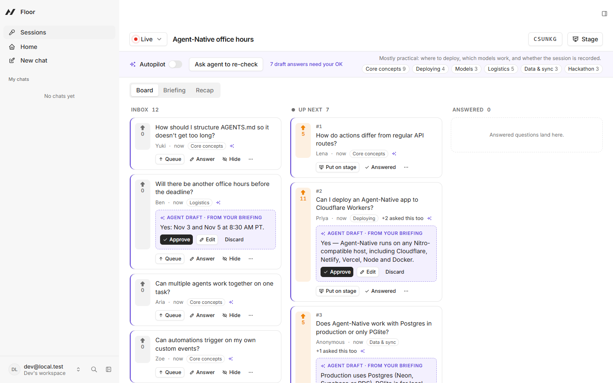
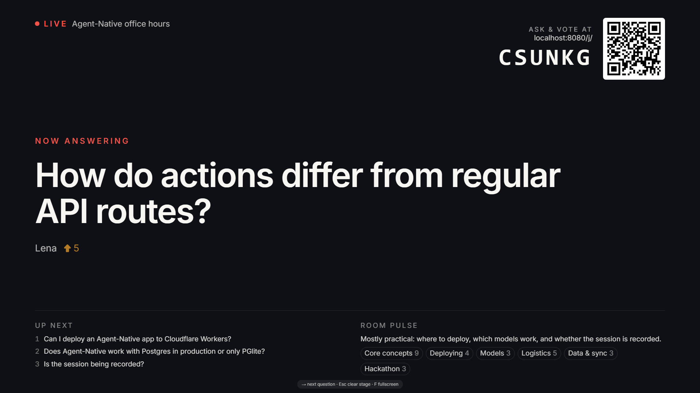
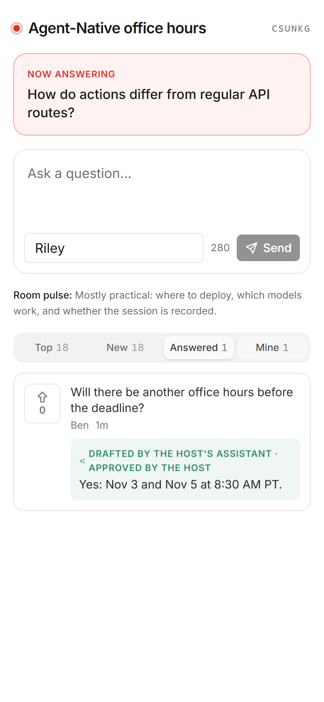
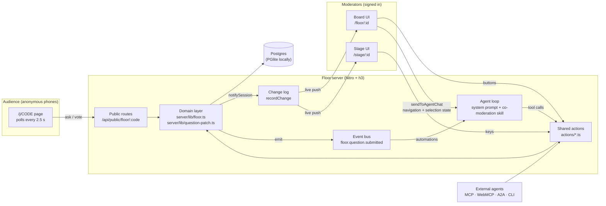
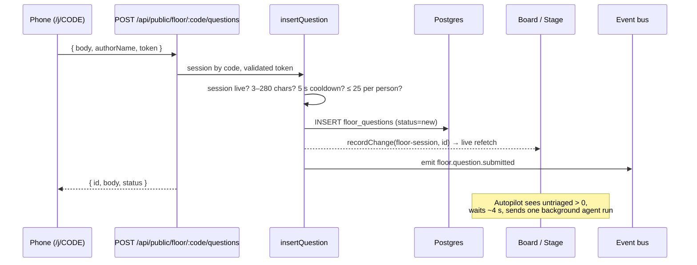
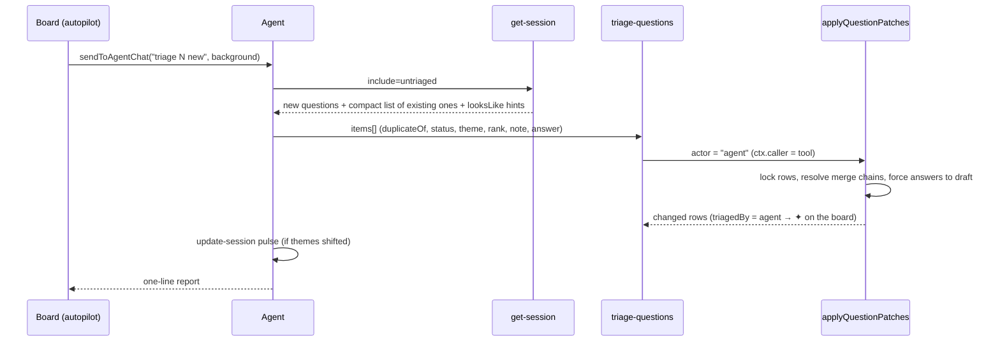
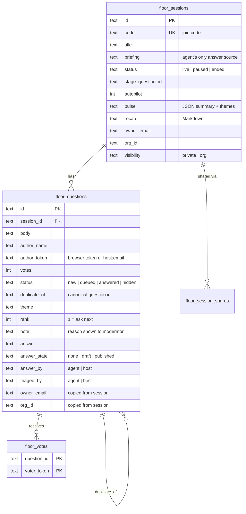
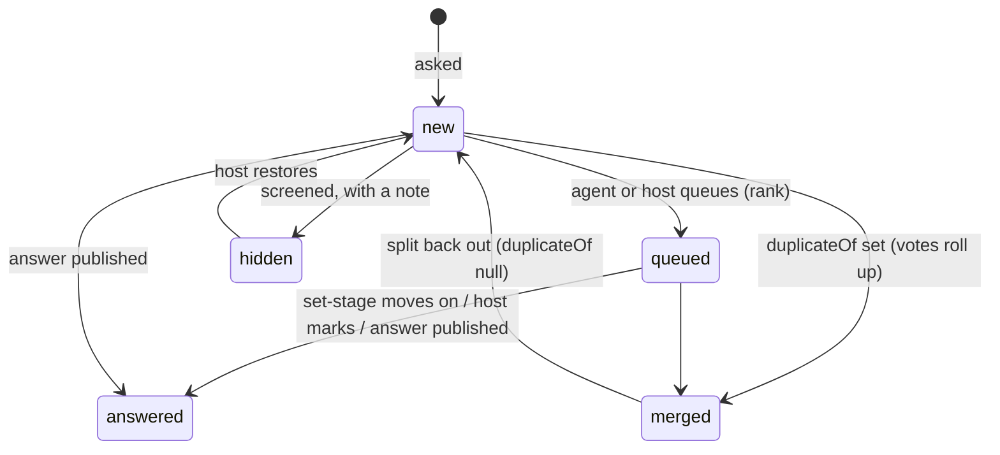

# Floor

**Live audience Q&A where an AI agent co-moderates and a person stays in charge.**

The audience asks and upvotes from their phones. While questions pour in, the
agent merges duplicates, screens out noise, groups themes, ranks what to ask
next and drafts answers from the host's notes. The moderator sees every agent
decision on a live board, can change any of it, and approves each answer before
the room sees it. A stage view drives the projector.

Built with [Agent-Native](https://agent-native.com) for the Builder.io
Agent-Native Hackathon.



| Stage (projector) | Audience (phone) |
| --- | --- |
|  |  |

---

## Contents

1. [The problem](#the-problem)
2. [What Floor does](#what-floor-does)
3. [A session, start to finish](#a-session-start-to-finish)
4. [Architecture](#architecture)
5. [Data model](#data-model)
6. [The trust contract and other invariants](#the-trust-contract-and-other-invariants)
7. [How it uses Agent-Native](#how-it-uses-agent-native)
8. [Action reference](#action-reference)
9. [Public audience API](#public-audience-api)
10. [Project layout](#project-layout)
11. [Run it locally](#run-it-locally)
12. [Configuration](#configuration)
13. [Deploying](#deploying)
14. [Tests and checks](#tests-and-checks)
15. [Troubleshooting](#troubleshooting)
16. [Built on](#built-on)

---

## The problem

Every all-hands, webinar, conference talk and office hour hits the same wall.
Forty questions arrive, fifteen of them are the same three questions in
different words, a few are spam, the moderator is scrolling instead of
listening, and the best questions are buried. Afterwards nobody knows what went
unanswered.

Existing Q&A tools collect questions and sort them by votes. Nothing reads
them for you. Fully automatic moderation goes too far the other way: you can't
let a model publish answers to a live audience unchecked.

Floor splits the work. The agent does the reading, sorting and drafting, which
is the tedious part. A person keeps every decision that reaches the audience.

## What Floor does

Floor has three screens and one agent.

| Screen | Who | Where | What it's for |
| --- | --- | --- | --- |
| **Board** | Moderator(s), signed in | `/floor/<sessionId>` | Inbox / Up next / Answered columns, plus Briefing, Recap and Hidden tabs. Every agent change is marked ✦ and can be undone. |
| **Stage** | The projector | `/stage/<sessionId>` | The current question in large type, the join QR code and the room pulse. Keyboard controlled. |
| **Audience** | Anyone with the code | `/j/<CODE>` | Ask, upvote, see published answers and track your own questions. No account. |

What each party does at each step:

| | The audience | The agent | The moderator |
| --- | --- | --- | --- |
| **Ask** | Ask and upvote at `/j/<code>`; no account | n/a | Add questions from the room mic |
| **Sort** | See merged questions' combined votes | Merges duplicates so votes add up; hides spam/off-topic **with a reason**; tags themes | Every agent change is marked ✦, and one click undoes, splits or restores it |
| **Prioritize** | Vote | Ranks *Up next* by votes, answerability and theme variety | Re-orders, queues, puts a question on stage |
| **Answer** | Gets written answers on their phone | Drafts answers **only from the host's briefing** | **Approves**, edits or discards each draft; the agent cannot publish |
| **Read the room** | Sees the room pulse | Keeps a live pulse: one-line summary + theme counts | Filters the board by theme |
| **Wrap up** | n/a | Writes the recap: answered, still open, what the room cared about | Copies the Markdown recap |

**Autopilot.** With autopilot on, the board hands each burst of new questions
to the agent in the background, so the board sorts itself while the moderator
listens. Bursts are batched: the board waits about 4 seconds so a flurry
becomes one agent run, and it won't re-send until the agent has made progress
or 90 seconds pass.

**A lexical safety net.** Even with no model connected, the board flags likely
duplicates. A cheap stemmed-word overlap score (`similarity()` in
`server/lib/floor.ts`, threshold 0.45) shows a "looks like…" hint on new
questions. The agent does the real semantic matching on top of that hint.

## A session, start to finish

1. **Open a session.** The moderator opens **Sessions** and names the session,
   or asks the agent ("open a session called Q3 all-hands"). The session gets
   a 6-character join code from an alphabet without look-alike characters (no
   `0/O`, `1/I/L`).
2. **Brief the agent.** The moderator pastes notes into **Briefing**: agenda,
   FAQs, links, known answers. The agent drafts answers from these notes only.
3. **The room joins.** Phones scan the QR code on the stage screen or type the
   code. Each browser generates a random token kept in `localStorage`, which
   identifies its questions and votes without an account.
4. **Questions arrive.** Each question is validated (3–280 characters),
   rate-limited (one per 5 s, 25 per person per session), stored, broadcast to
   open boards, and emitted as a `floor.question.submitted` event.
5. **Triage.** Autopilot or the **Triage N new** button asks the agent to run
   the co-moderation playbook. The agent reads the new questions, then sends
   one `triage-questions` batch that merges, hides, themes, queues, ranks and
   attaches drafts in a single transaction.
6. **Moderate.** The moderator reviews the ✦ marks, approves or edits drafts,
   splits wrong merges and restores wrongly hidden questions.
7. **On stage.** Press → on the stage screen (or ask the agent to "put the top
   question up"). The previous stage question is marked answered.
8. **Wrap up.** End the session and press **Write recap**. The agent writes a
   Markdown summary of what was answered live, answered in writing, still
   open, and what the room cared about.

## Architecture

### Overview



### Layers

**1. Domain layer (`server/lib/`).** Every rule lives here, once:

- `floor.ts`: session lookup with access control (`requireSession`), join
  codes, question validation and rate limits (`insertQuestion`), vote toggling
  (`toggleVote`), the board read model (`boardQuestions`, which folds
  duplicates under their canonical question and rolls up votes), the
  audience-safe projection (`publicSnapshot`), the duplicate hint scorer, and
  the caller → actor mapping (`actorFor`).
- `question-patch.ts`: `applyQuestionPatches`, the single write path for
  moderating questions. It locks the session's questions, applies a batch of
  patches in memory, enforces the merge and publishing rules, and writes the
  dirty rows in one transaction.
- `public-request.ts`: helpers for the anonymous routes: token validation,
  `no-store` caching, and turning domain `fail()` errors into JSON replies.

**2. Shared actions (`actions/`).** Thin `defineAction` wrappers over the
domain layer. Each declares a Zod schema (which doubles as the agent's tool
description), the access level it needs, a deep link back to the board, and
the resource it changes. The framework exposes every action to the board UI
(typed React Query hooks), the agent (tools), the CLI (`pnpm action <name>`),
HTTP, MCP and WebMCP. **The board's buttons and the agent call the same
code**, so they can't drift apart.

**3. Public routes (`server/routes/api/public/`).** Three small h3 handlers for
anonymous phones. They reuse `insertQuestion`, `toggleVote` and
`publicSnapshot` from the domain layer instead of duplicating rules.

**4. UI (`app/`).** React Router 8 file routes:

- `floor._index.tsx`: session list and "new session".
- `floor.$sessionId.tsx`: the board, autopilot and the agent buttons.
- `stage.$sessionId.tsx`: projector view with keyboard control.
- `j.$code.tsx`: the phone view.
- `components/floor/`: `QuestionCard`, `QrCode`, `MiniMarkdown` and
  `use-board.ts` (the board's queries and optimistic mutations: a merge moves
  the card and adds its votes to the target before the server answers).

**5. Agent (`server/plugins/agent-chat.ts`, `.agents/skills/co-moderation/`,
`AGENTS.md`).** The system prompt lists the agent's jobs in priority order.
The co-moderation skill is its detailed playbook: what counts as a duplicate,
when to hide, theme naming, ranking, answer sourcing, and the recap format.
The agent starts with a curated tool set (`view-screen`, the Floor actions,
`navigate`) so it doesn't waste turns discovering tools.

### Key flows

**An audience question arrives**



**The agent triages a batch**



**Approving an answer.** The moderator clicks **Approve** on a draft, which
calls `update-question { answerState: "published" }` with
`ctx.caller = frontend`, so the actor is `host`. The answer becomes visible in
`publicSnapshot`, the phone shows it on its next poll, and the card keeps
"drafted by the host's assistant · approved by the host" unless the moderator
rewrote the text, in which case the host gets the credit.

### Live updates

- **Moderators** use `useDbSync({ realtime })`. Every write that touches a
  session calls `notifySession()`, which records a change keyed to that
  `floor-session` resource. Every open board and stage for the session
  refetches, including co-moderators in the same org. Mutating actions also
  declare `changeResource`, so agent and CLI writes propagate the same way.
- **The audience** is anonymous and has no sync channel, so the phone page
  polls `GET /api/public/floor/:code` every 2.5 s with `Cache-Control:
  no-store`. That is cheap (one indexed query per poll) and works through any
  proxy.

### Context awareness

The agent knows what the moderator is looking at without being told:

- **Navigation state** carries `view`, `sessionId` and the active `tab`.
- **Selection state:** clicking a card writes
  `{ kind: "floor.question", sessionId, questionId, label }`. It is cleared
  when the board unmounts.
- **`view-screen`** merges both into a live snapshot: session title, code,
  status, autopilot, whether a briefing exists, the pulse, stats (total,
  untriaged, queued, drafts, hidden), the stage question, the top five of
  Up next, and the selected question with its current draft.

So "draft an answer for this" or "why did you hide that?" resolve to the right
question.

## Data model

Three tables plus the framework's share table. The migration is
`server/plugins/db.ts`, tracked in `floor_app_migrations`.



**Why `owner_email`/`org_id` sit on every row.** Questions and votes copy their
session's owner and org. The framework's agent SQL tools are scoped by tenant,
so the agent can't read another tenant's questions, even through ad-hoc SQL.

### Question lifecycle



Answers have their own small state machine: `none → draft → published`. Only
a person can move a draft to `published`.

## The trust contract and other invariants

The core rule: **anything the audience sees from the agent passes a person
first.** The rule lives in `applyQuestionPatches`, the single write path, not
in the UI:

| Rule | Where it's enforced | Tested in |
| --- | --- | --- |
| Agent answers are always saved as drafts | `question-patch.ts`, `actor === "agent"` branch | `question-patch.spec.ts` |
| The agent can't publish (`needs_host_approval`, 403) | same | `question-patch.spec.ts` |
| Approving the agent's draft keeps the agent's credit; rewriting it credits the host | same | `question-patch.spec.ts` |
| Every agent-like caller counts as the agent: `tool`, `automation`, `mcp`, `webmcp`, `a2a` | `actorFor()` in `floor.ts` | `floor.spec.ts` |
| Duplicates always point at a canonical question; merging a parent re-points its children | `canonicalOf()` + re-pointing loop | `question-patch.spec.ts` |
| A batch with an id from another session writes nothing | id check before any write, inside the transaction | `question-patch.spec.ts` |
| The audience never sees hidden questions (except their own), drafts, notes, tokens or the briefing | `publicSnapshot()` | `floor.spec.ts` |
| One vote per person per question, even under concurrent taps | composite PK `(question_id, voter_token)` + row lock + `ON CONFLICT DO NOTHING` | schema |
| No self-merge | `CHECK (duplicate_of <> id)` + domain check | schema |
| Valid enum values | SQL `CHECK` constraints on every status column | schema |
| Spam resistance | per-token 5 s cooldown and 25-question cap; 4 KB body limit; strict token format | `floor.ts`, public routes |

Because the rule sits in the action layer, it holds for every path in: chat,
autopilot, user-built automations, Claude Desktop over MCP, browser agents over
WebMCP, and other agents over A2A.

## How it uses Agent-Native

| Framework piece | In Floor |
| --- | --- |
| **Shared actions** | 8 domain actions (`actions/`) are the single contract for the board UI, the agent, the CLI, HTTP, MCP and WebMCP. |
| **Caller-aware actions** | `ctx.caller` separates agent calls from human calls, so agent decisions are stamped ✦ and agent answers are forced to drafts. |
| **Context awareness** | Navigation + selection app state, surfaced through an extended `view-screen`. |
| **`sendToAgentChat`** | "Triage N new", "Ask agent to draft an answer", "Write recap", and autopilot (`background: true`, so the sidebar stays closed). |
| **Live sync** | `useDbSync({ realtime })` on board and stage; `recordChange` from anonymous public writes; `changeResource` on mutating actions. |
| **Event bus + automations** | `floor.question.submitted` is registered with a payload schema and example (`server/plugins/floor-events.ts`), so users can ask for automations like "when someone asks about pricing, ping me" with no code change. |
| **Skills + AGENTS.md** | `.agents/skills/co-moderation/SKILL.md` is the triage playbook; the `## Floor` section of `AGENTS.md` orients coding agents working on the app. |
| **Sharing** | `floor-session` is a registered shareable resource (`ownableColumns`, `createSharesTable`, `accessFilter`). Sessions are org-visible when an org is active; questions inherit access. |
| **Public paths** | `/j` and `/api/public` are listed in `publicPaths` (`server/plugins/auth.ts`); everything else requires sign-in. |
| **Deep links** | Actions return links like "Open board" so agent replies point straight to the right screen. |
| **i18n** | All UI strings go through `useT()` with catalogs in `app/i18n/`. |

## Action reference

Call any of these from the agent, the UI, or the CLI (`pnpm action <name> --arg value`).

| Action | Access | What it does |
| --- | --- | --- |
| `list-sessions` | viewer | Sessions you can see, newest first. |
| `create-session` | signed in | Opens a session; returns `id`, join `code`, `joinPath`. Retries on code collisions. |
| `get-session` | viewer | Session + stats + questions folded by duplicates. `include: all \| untriaged \| none`; `untriaged` also returns a compact list of existing questions to match against. |
| `update-session` | editor | Title, briefing, `status` (live/paused/ended), `autopilot`, `pulse`, `recap`. |
| `triage-questions` | editor | Batch of up to 100 question patches in one transaction. |
| `update-question` | editor | Patch one question: status, theme, rank, note, `duplicateOf` (merge or split), `answer`, `answerState`. |
| `set-stage` | editor | Put a canonical, visible question on stage (or `null` to clear); the previous one becomes answered. |
| `submit-question` | editor | Add a question for someone, e.g. from the room mic. Skips audience rate limits. |
| `view-screen` | read-only | What the moderator is looking at (see [Context awareness](#context-awareness)). |

The question patch fields are shared between `triage-questions` and
`update-question` (`questionPatchFields` in `server/lib/question-patch.ts`),
so the agent sees the same field descriptions in both tools.

## Public audience API

No authentication. `token` is a random 16–64 character `[A-Za-z0-9_-]` string
the browser generates and keeps.

| Method | Path | Body / query | Returns |
| --- | --- | --- | --- |
| `GET` | `/api/public/floor/:code` | `?token=` | `{ session, questions, mine }`: visible questions with rolled-up votes, published answers, `voted` and `onStage` flags; `mine` lists your own questions, including hidden or merged ones. |
| `POST` | `/api/public/floor/:code/questions` | `{ body, authorName?, token }` | `{ id, body, status }` |
| `POST` | `/api/public/floor/:code/votes` | `{ questionId, token }` | `{ voted, votes }` (a toggle) |

Errors come back as `{ error, message }` with codes like `too_short`,
`too_long`, `slow_down` (429), `limit_reached` (429), `session_paused` (409),
`session_closed` (409) and `not_found` (404).

## Project layout

```
floor/
├── actions/                    # shared actions = the app's API (UI, agent, CLI, MCP)
│   ├── create-session.ts  get-session.ts  list-sessions.ts  update-session.ts
│   ├── triage-questions.ts  update-question.ts  set-stage.ts  submit-question.ts
│   └── view-screen.ts          # context awareness for the agent
├── server/
│   ├── db/schema.ts            # Drizzle tables
│   ├── db/index.ts             # getDb + shareable-resource registration
│   ├── lib/floor.ts            # domain rules, read models, public snapshot
│   ├── lib/question-patch.ts   # the single moderation write path
│   ├── lib/*.spec.ts           # invariant tests
│   ├── routes/api/public/floor # anonymous audience endpoints
│   └── plugins/
│       ├── db.ts               # SQL migrations
│       ├── agent-chat.ts       # agent system prompt + initial tools
│       ├── floor-events.ts     # floor.question.submitted
│       └── auth.ts             # public paths
├── app/
│   ├── routes/floor*.tsx       # sessions list + moderator board
│   ├── routes/stage.$sessionId.tsx
│   ├── routes/j.$code.tsx      # audience phone view
│   ├── components/floor/       # QuestionCard, QrCode, MiniMarkdown, use-board
│   └── i18n/                   # UI string catalogs
├── .agents/skills/co-moderation/SKILL.md   # the agent's triage playbook
├── AGENTS.md                   # guidance for coding agents (see "## Floor")
├── scripts/
│   ├── simulate-audience.ts    # fake room through the real public API
│   └── migrate-production.ts   # run migrations against DATABASE_URL
└── docs/screenshots/
```

## Run it locally

**Requirements**

- Node.js **≥ 22.22** (older 22.x releases fail at startup)
- pnpm (`corepack enable`)
- An LLM connection for the agent: an Anthropic or OpenAI key, Builder.io, or
  local Ollama, set in the app's agent settings or via env vars.

No database setup is needed: locally the app uses embedded PGlite under
`data/`.

```bash
pnpm install
pnpm dev                  # http://localhost:8080 → "Continue as local dev"
```

**Try a full session**

1. Open **Sessions**, name a session and open the floor. Paste your notes into **Briefing**.
2. Join from a phone with the QR code (see *Phones on your network* below), or simulate a room:
   ```bash
   pnpm simulate <CODE>              # ~30 realistic questions + votes via the public API
   pnpm simulate <CODE> --fast       # 4× faster
   pnpm simulate <CODE> --voters 80  # more voters
   pnpm simulate <CODE> --base https://your-deploy.example.com
   ```
   The simulated room deliberately includes reworded duplicates
   ("Can I deploy to Cloudflare?" / "Can I deploy on Workers…?"), an ad and an
   off-topic message, so the agent has real triage work.
3. Turn on **Autopilot**, or press **Triage N new**, and watch the board sort itself.
4. Approve drafts, then open **Stage** for the projector:
   **→ / N / Space** next question, **Esc** clear, **F** fullscreen.
5. End the session and open **Recap** → **Write recap**.

**Phones on your network.** Local dev sign-in only works on `localhost`, so the
moderator stays on localhost. Point the join link and QR code at your LAN or
tunnel address with `VITE_FLOOR_JOIN_ORIGIN` in `.env`.

**Things to ask the agent**

- "Triage the new questions and tell me what you hid."
- "Draft answers for anything the briefing covers."
- "Put the top question on stage."
- "What is the room most worried about?"
- "When someone asks about pricing in this session, message me."
- "Write the recap."

## Configuration

| Variable | Needed | Purpose |
| --- | --- | --- |
| `DATABASE_URL` | production | Postgres connection string (e.g. Neon). Unset locally → PGlite. |
| `BETTER_AUTH_SECRET` | production | Stable secret for sessions. Generate with `openssl rand -base64 32`. |
| `ANTHROPIC_API_KEY` (or another provider key) | for the agent | Model access. Can also be set in the app's agent settings. |
| `VITE_FLOOR_JOIN_ORIGIN` | optional | Origin used in join links and QR codes (LAN IP, tunnel or deploy URL). |
| `AUTH_DISABLED` | local/preview only | Skips login. Never set it in production. |

See `.env.example`. Never commit `.env`.

## Deploying

Floor needs a long-running Node server for live push to moderators, plus
Postgres. A tested setup is **Render (web service) + Neon (Postgres)**.
Serverless hosts work for the API, but they can't hold the realtime channel
open, so boards would fall back to slower refreshes.

1. **Create the database** (e.g. Neon) and copy its pooled connection string.
2. **Run migrations once** from your machine:
   ```powershell
   $env:DATABASE_URL = '<connection string>'
   pnpm migrate:production
   Remove-Item Env:DATABASE_URL
   ```
   This applies the framework's migrations and Floor's
   `floor-sessions-questions-votes` migration.
3. **Create the web service**:
   - Build command: `corepack enable && pnpm install --frozen-lockfile && pnpm build`
   - Start command: `pnpm start`
   - Environment: `DATABASE_URL`, `BETTER_AUTH_SECRET`, `ANTHROPIC_API_KEY`,
     `NODE_VERSION=22.22.0` (or newer)
4. Open the deployed URL, sign up, create a session, and join from a phone.
   No `VITE_FLOOR_JOIN_ORIGIN` is needed, because the deploy URL is already
   public.

## Tests and checks

```bash
pnpm test                   # vitest: domain + invariant tests
pnpm typecheck
pnpm agent-native:doctor    # framework conventions (actions, routes, sync)
```

What the tests cover:

- reworded duplicates score above unrelated questions; hints appear only on untriaged questions
- duplicates fold under their canonical question with votes rolled up
- the audience never sees hidden questions, drafts, notes, tokens or the briefing, but does see their own questions, including hidden and merged ones
- agent loops and external agents count as the agent; people count as the host
- agent answers stay drafts even if the agent later tries to publish
- approving an agent draft keeps its credit; rewriting it credits the host
- merges re-point existing duplicates to the canonical question
- a batch containing an id from another session writes nothing

## Troubleshooting

| Symptom | Fix |
| --- | --- |
| Dev server crashes at start on Node 22.x | Upgrade to Node ≥ 22.22. |
| Phones can't reach the join link | Set `VITE_FLOOR_JOIN_ORIGIN` to your LAN IP or a tunnel URL and make sure the phone is on the same network. |
| "Continue as local dev" fails from another device | Expected: local dev sign-in is localhost-only. Moderate from localhost; only the audience joins remotely. |
| Agent buttons do nothing | Connect a model in the agent settings (or set a provider key). |
| `getaddrinfo ENOTFOUND *.neon.tech` / Neon console "Failed to fetch" | Your network's DNS is blocking the host. Switch the OS or browser to a public DNS (e.g. 1.1.1.1). |
| Agent says it can't publish | Working as intended: approve the draft on the board. |

## Built on

Scaffolded with `npx @agent-native/core create floor --template chat`. The
framework, chat shell, authentication and agent sidebar come from that
template. Everything Floor-specific was written during the hackathon:

- data model, migrations and sharing registration (`server/db`, `server/plugins/db.ts`)
- domain logic, rules and the public audience API (`server/lib`, `server/routes/api/public`)
- the 8 Floor actions and the extended `view-screen` (`actions/`)
- the event registration (`server/plugins/floor-events.ts`)
- the board, stage and audience UIs (`app/routes/floor*`, `stage.*`, `j.*`, `app/components/floor`)
- the agent prompt, `AGENTS.md` section and co-moderation skill
- the audience simulator, tests and screenshots

Third-party additions: [`qrcode-generator`](https://github.com/kazuhikoarase/qrcode-generator) (MIT).
